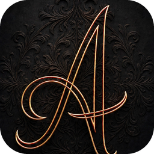

<p align="center"></p>

# AlphaCad

Лёгкий 3D CAD-редактор на Rust для просмотра, создания и редактирования 3D-моделей.
Интерфейс устроен по образцу Fusion 360. Это независимая реализация (clean room),
с Autodesk она не связана.

## Возможности (версия 0.2)

- **Форматы:** STL (двоичный и ASCII), STEP (AP203/AP214 — импорт фасетированных
  и плоских B-rep, экспорт сеткой), **3MF** (сетки, компоненты, сборка, единицы
  измерения, цвета; экспорт со сжатием), OBJ, PLY, собственный проект `.acad`
  (проекты `.forge` прежних версий тоже открываются).
- **Твёрдые тела:** параллелепипед, цилиндр, сфера, тор, конус, труба, клин,
  пирамида, капсула. Параметры примитивов можно менять после создания.
- **Эскизы:** линия, прямоугольник, окружность на плоскостях XY/XZ/YZ, привязка к
  сетке и точкам, выдавливание (новое тело / соединить / вырезать / пересечь).
- **Изменение:** перемещение, поворот, масштаб (манипуляторы и точный ввод),
  булевы операции, зеркало, дублирование, опускание на плоскость,
  применение трансформации.
- **Сетка:** сварка вершин, исправление ориентации нормалей, разворот нормалей,
  упрощение (децимация), стиль затенения.
- **Инспекция:** измерение расстояний, объём, площадь, центр масс, габариты,
  проверка замкнутости.
- **Интерфейс:** светлая и тёмная (графит) темы, лента инструментов, браузер,
  панель свойств, ViewCube, панель навигации, временная шкала истории, отмена и
  повтор (200 шагов), контекстные меню, русский и английский языки,
  перетаскивание файлов в окно, **несколько окон** («Файл → Новое окно»,
  Ctrl+Shift+N) для параллельной работы с разными проектами.
- **Рендер на выбор** («Настройки → Расчёт графики»):
  - **Процессор** — многопоточный программный рендер, работает на любом компьютере;
  - **Видеокарта** — OpenGL 2.1 (Windows — WGL, macOS — CGL). Если драйвер
    недоступен, программа сама возвращается к процессору и показывает причину.
- **Для слабых компьютеров:** сниженное разрешение во время вращения вида,
  перерисовка только при изменениях. Нет внешних зависимостей, бинарник
  занимает несколько мегабайт.

## Установка

- **Windows 10/11 x64:** запустите `AlphaCad-<версия>-windows-x64-setup.exe`
  (тёмный мастер установки). Есть и переносная версия (`…-portable.zip`).
- **macOS 12+ (Intel и Apple Silicon):** откройте `AlphaCad-<версия>-macos-universal.dmg`
  и перетащите AlphaCad в «Программы». Приложение не нотарифицировано Apple,
  поэтому при первом запуске откройте его через контекстное меню (правый клик →
  «Открыть»). Если macOS сообщает, что приложение «повреждено», выполните
  `xattr -cr /Applications/AlphaCad.app`.

Настройки прежней версии (ForgeCAD) переносятся автоматически.

## Управление

| Действие | Клавиши / мышь |
|---|---|
| Вращение / сдвиг / масштаб вида | ЛКМ / ПКМ или СКМ / колесо |
| Вписать / начальный вид | F / Home |
| Виды спереди / справа / сверху | 1 / 3 / 7 |
| Выбор / перемещение / поворот / масштаб | V / M / R / S |
| Выдавить / измерить | E / I |
| Эскиз: линия / прямоугольник / окружность | L / R / C |
| Новый проект / новое окно | Ctrl+N / Ctrl+Shift+N |
| Отменить / повторить | Ctrl+Z / Ctrl+Y (на macOS — ⌘) |
| Справка | F1 |

## Командная строка

```text
alphacad [файлы…]                          запуск редактора
alphacad info model.3mf                    сведения о модели
alphacad convert model.step model.3mf      конвертация (формат по расширению)
alphacad snapshot out.png model.stl        снимок интерфейса без окна
         [--theme light|dark] [--render cpu|gpu] [--require-gpu]
```

## Сборка из исходников

Нужен Rust stable (1.77+).

```sh
cargo build --release
cargo test --lib
```

Установщики собираются в GitHub Actions (`.github/workflows/build.yml`):

- Windows: Inno Setup 6.7+ (тёмная тема, логотип на фоне мастера);
- macOS: универсальный `.app` и `.dmg` с тёмным фоном, `MACOSX_DEPLOYMENT_TARGET=12.0`.

Сборка запускается при каждом push. Тег `v*` публикует релиз.

## Структура

| Модуль | Назначение |
|---|---|
| `math` | векторы, матрицы, геометрия |
| `mesh` | сетки и примитивы |
| `csg` | булевы операции (BSP) |
| `formats` | STL / STEP / 3MF (+ ZIP/Deflate) / OBJ / PLY / `.acad` |
| `sketch` | 2D-эскизы, выдавливание |
| `scene` | тела, история отмены |
| `renderer` | программный рендер, OpenGL-рендер, 2D-графика |
| `ui` | immediate-mode интерфейс, темы, шрифт, иконки |
| `app` | приложение: панели, 3D-вид, команды, диалоги |
| `platform` | Win32 / Cocoa (FFI без внешних крейтов) |

## Лицензия

MIT. Шрифт интерфейса — подмножество DejaVu Sans (см. `assets/fonts/LICENSE-DejaVu.txt`).

Designed by Alex Abmaev.
